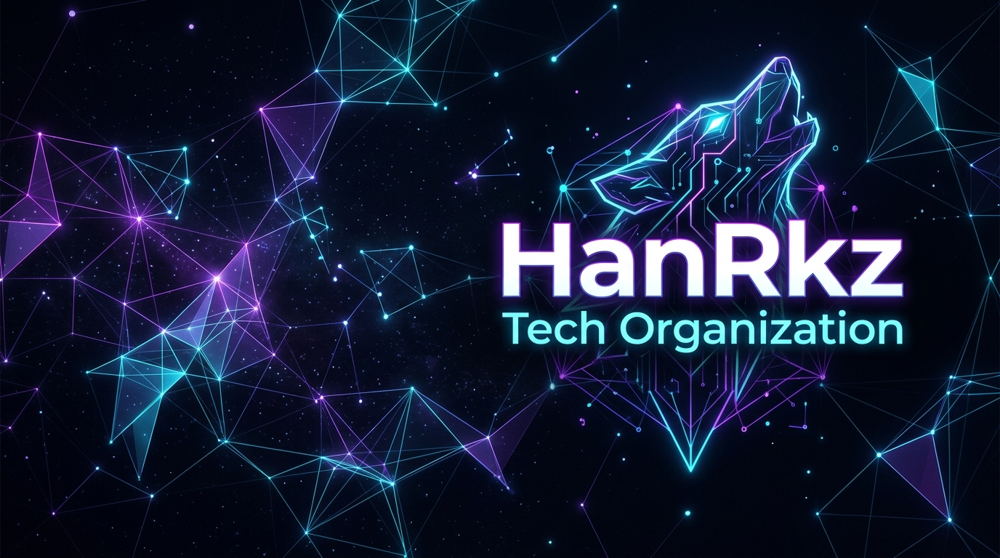
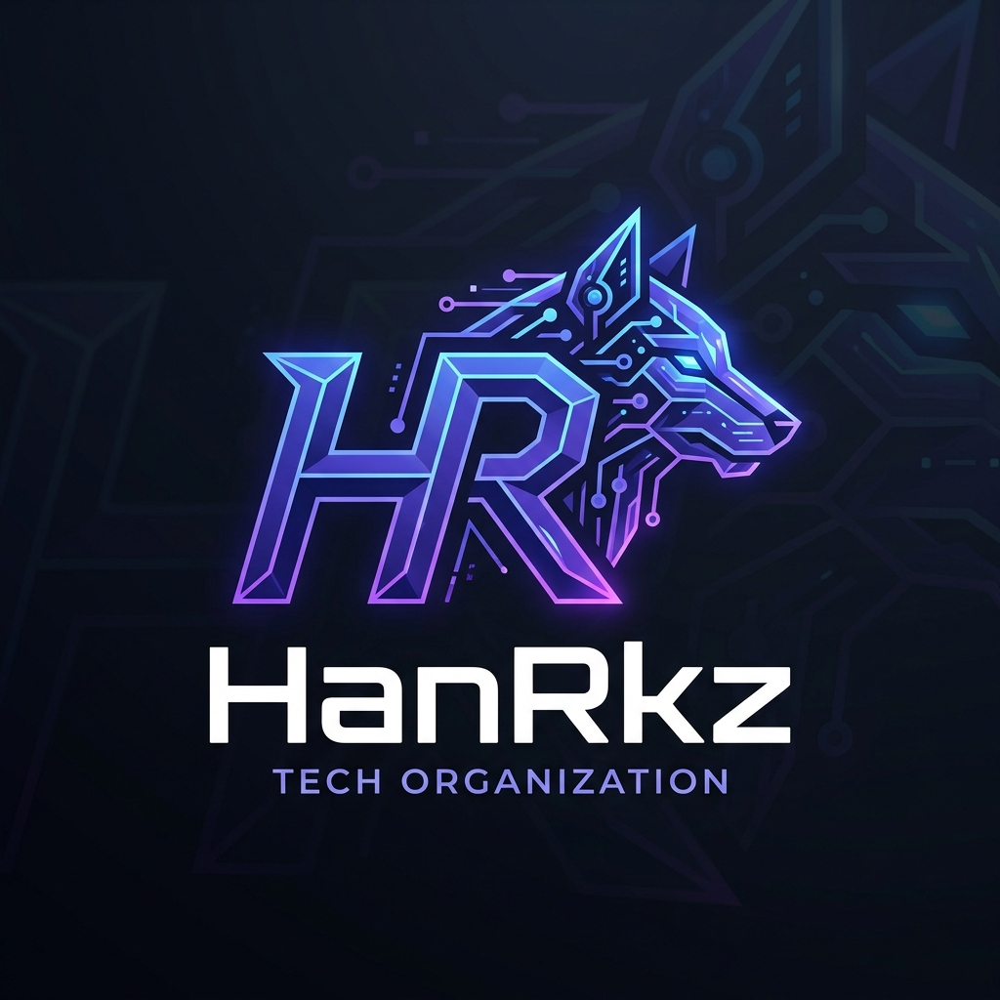

<p align="center">
  
</p>

<p align="center">
  
</p>

<h1 align="center">HanRkz</h1>

<p align="center">
  <strong>Engineering high-impact SaaS platforms, sports technology ecosystems, and enterprise automation engines.</strong>
</p>

<p align="center">
  <a href="https://github.com/Archebiz"></a>
  <a href="https://github.com/HanRkz"></a>
  
  
</p>

---

## 🧭 About HanRkz

**HanRkz** is an engineering-driven software organization and technology lab founded by [**Adrian Salazar Padilla (@Archebiz)**](https://github.com/Archebiz). 

We architect, build, and deploy robust digital products focused on:
- **Sports Technology & Tournament Algorithms**: End-to-end administration software for clubs, academies, and competitive circuits.
- **Enterprise SaaS & Financial Systems**: Cloud solutions featuring strict multi-tenant isolation, automated payment gateways, and accounting ledgers.
- **Industrial Automation & Traceability**: Quality control, batch management, and high-performance reporting engines.

Our software philosophy marries **analytical and structural engineering rigor** with modern cloud architectures, emphasizing **Clean Architecture**, **Domain-Driven Design (DDD)**, and strict operational security.

---

## 🛠️ Technology Ecosystem

### Backend & Core APIs


### Cross-Platform & Frontend


### Databases & Persistence


### Cloud, Infrastructure & DevOps


---

## 🚀 Key Projects & Product Suite

```
  ┌────────────────────────────────────────────────────────────────────────┐
  │                           HANRKZ ECOSYSTEM                             │
  └────────────────────────────────────────────────────────────────────────┘
         │                          │                         │
         ▼                          ▼                         ▼
  [ SPORTS TECH ]            [ SAAS & FINANCE ]       [ INDUSTRIAL & TOOLS ]
   • RallyTrackApp            • WolveFinances          • Control Procesos Envasados
   • RoundRobinApp            • FinanceApp             • OpenXML Report Engine
                              • CanchaPro Core         • Productivity Utilities
```

### 🎾 [RallyTrackApp](https://github.com/HanRkz/RallyTrackApp)
> **Comprehensive Management & Commercial System for Tennis and Racket Academies**
- **Architecture**: Single-Tenant per client deployment, isolated databases, custom white-label identity, and public landing page with self-serve student enrollment.
- **Tech Stack**: Flutter 3.35+ (Riverpod 3, GoRouter, FL Chart), ASP.NET Core Web API (.NET 10 LTS), EF Core 10, PostgreSQL 16, Docker, Railway.
- **Key Features**: Court booking reservation engine with concurrency locks, player ranking, attendance logs, cash flow balance, and automated quota enforcement.

### 🐺 [The Wolves Finances / CanchaPro](https://github.com/HanRkz/WolveFinances)
> **Multi-Tenant SaaS Platform for Sports Clubs & Athletic Leagues**
- **Architecture**: Multi-tenant architecture with strict database isolation by `ClubId` (`IMustHaveClub`), lightweight dynamic white-labeling (dynamic CSS variables per club).
- **Tech Stack**: ASP.NET Core Clean Architecture, Angular, TypeScript, PrimeNG, PostgreSQL / MariaDB.
- **Monetization & Billing**: Native integration with **Mercado Pago Preapproval API** for recurring monthly membership dues, with constant-time cryptographic webhook verification (`CryptographicOperations.FixedTimeEquals`).
- **Sports Management**: Matchday fixture management, live scorekeeping, goal/save player metrics, disciplinary fines, and raffle modules.

### 🏆 [RoundRobinApp](https://github.com/HanRkz/RoundRobinApp)
> **Tournament Administration & Match Scheduling Platform**
- **Core Engine**: Mathematical Round Robin scheduling algorithms, dynamic group rotation matrices, and automatic bracket generation.
- **Operations**: Real-time match scoring dashboard, session management, court assignment dispatcher, and live standings computation.
- **Tech Stack**: ASP.NET Core Web API, Flutter / Web Client, PostgreSQL.

### 🏭 [Control de Procesos de Envasado](https://github.com/HanRkz/ControlProcesosEnvasados)
> **Industrial Packaging Process Control & Traceability System**
- **Capabilities**: End-to-end production tracking from raw material order to finished packaged product.
- **Quality Assurance**: Real-time sensor and operator measurement logging, tolerance enforcement, non-conformance root-cause analysis, and operational efficiency audits.
- **Data Engineering**: High-integrity relational schema designed with DBML and SQL optimization.

### 📊 [FinanceApp](https://github.com/HanRkz/FinanceApp)
> **Enterprise Accounting, Cash-Flow & Budget Tracking Suite**
- **Capabilities**: Organizational ledger, categorised transaction logs, multi-account reconciliations, and budget forecasting charts.
- **Tech Stack**: .NET Backend API, Responsive Single Page Application (SPA), relational persistence.

### ⚡ Developer & Productivity Utilities
- **[OpenStickyMemos](https://github.com/Archebiz/OpenStickyMemos)**: Collaborative real-time workspace and sticky notes system with user `@mentions`, role permissions, and canvas persistence (.NET + Angular).
- **[MarkdownToPDF](https://github.com/Archebiz/markdowntoPDF)**: High-performance document compilation engine with instant preview and print-ready multi-format layout rendering.

---

## 🏛️ Engineering Philosophy & Architecture Standards

1. **Clean Architecture & Domain-Driven Design (DDD)**
   - Strict layer separation (`Domain`, `Application`, `Infrastructure`, `Api`).
   - Core domain business rules remain 100% framework-agnostic.
2. **Security & Cryptographic Reliability**
   - PBKDF2 / Argon2 password hashing.
   - HMAC-SHA256 signature verification with constant-time equality checks against timing attacks.
   - JWT with fine-grained claim-based and role-based permissions.
3. **Multi-Tenancy vs. Single-Tenancy by Design**
   - *Multi-tenant SaaS* (e.g. CanchaPro) with mandatory query filters preventing cross-tenant data leaks.
   - *Single-tenant containerized deployments* (e.g. RallyTrackApp) ensuring dedicated compute and compliance for higher-tier organizations.
4. **Automated CI/CD & Cloud Orchestration**
   - Containerized development via Docker Compose.
   - Cloud deployments with automated health checks, environment secrets management, and zero-downtime rollouts via Railway and Docker.

---

## 👥 Leadership & Organization Founders

<table>
  <tr>
    <td align="center" width="200">
      <a href="https://github.com/Archebiz">
        
        <br />
        <sub><b>Adrian Salazar Padilla</b></sub>
      </a>
      <br />
      <sub>Founder & Tech Lead</sub>
      <br />
      <a href="https://github.com/Archebiz">
        
      </a>
      <br />
      <a href="https://www.linkedin.com/in/adriansalazarpadilla/">
        
      </a>
    </td>
    <td>
      <h3>Adrian Salazar Padilla — Founder & Lead Architect</h3>
      <p>
        Software engineer with a civil engineering foundation (UNMSM). Specializes in high-throughput <b>.NET (C#)</b> backend ecosystems, <b>Flutter / Angular</b> client architectures, and distributed systems design. Leads the vision, system architecture, and product development across the HanRkz ecosystem.
      </p>
    </td>
  </tr>
</table>

---

## 📈 Activity & Metrics

<p align="center">
  
  
</p>

---

<details>
<summary><b>🇪🇸 Haz clic aquí para ver la versión en Español</b></summary>

<br />

# Organización HanRkz

**Ingeniería de software, plataformas SaaS de alto impacto, tecnología deportiva y motores de automatización empresarial.**

### 🧭 Sobre HanRkz
**HanRkz** es una organización de desarrollo de software y laboratorio tecnológico fundada por [**Adrian Salazar Padilla (@Archebiz)**](https://github.com/Archebiz). Diseñamos soluciones digitales escalables aplicando principios de **Clean Architecture**, **Domain-Driven Design (DDD)** y rigor ingenieril.

### 🚀 Ecosistema de Productos
1. **RallyTrackApp**: Software comercializable y personalizable para la administración integral de academias de tenis y deportes de raqueta (Flutter 3.35+, ASP.NET Core .NET 10 LTS, PostgreSQL 16, Railway).
2. **The Wolves Finances / CanchaPro**: Plataforma SaaS multi-tenant para clubes deportivos con suscripciones automáticas vía Mercado Pago API y liquidación de cuotas.
3. **RoundRobinApp**: Algoritmos de calendarización Round Robin y panel de control en vivo para torneos y competiciones.
4. **Control de Procesos de Envasado**: Trazabilidad completa, control de calidad y analítica industrial de lotes de producción.
5. **FinanceApp**: Plataforma de gestión financiera, tesorería y presupuestos.
6. **Herramientas de Productividad**: OpenStickyMemos (notas adhesivas colaborativas en tiempo real) y MarkdownToPDF (compilador de documentos a PDF de alto rendimiento).

### 🛠️ Stack Tecnológico Principal
- **Backend**: C#, .NET 8 / 10 LTS, ASP.NET Core Web API, Entity Framework Core, Laravel, JWT.
- **Frontend & Móvil**: Flutter, Dart, Riverpod, Angular, TypeScript, PrimeNG, HTML5/CSS3.
- **Bases de Datos**: PostgreSQL 16, Microsoft SQL Server, MariaDB, MySQL, Firebase.
- **DevOps e Infraestructura**: Docker, Docker Compose, Railway, Mercado Pago API, OpenXML.

### 📬 Contacto y Comunidad
- **Organización GitHub**: [@HanRkz](https://github.com/HanRkz)
- **Fundador & Lead Developer**: [Adrian Salazar Padilla (@Archebiz)](https://github.com/Archebiz)
- **LinkedIn del Fundador**: [adriansalazarpadilla](https://www.linkedin.com/in/adriansalazarpadilla/)

</details>

---

<p align="center">
  <sub>© HanRkz Organization. Engineered with precision and passion.</sub>
</p>
